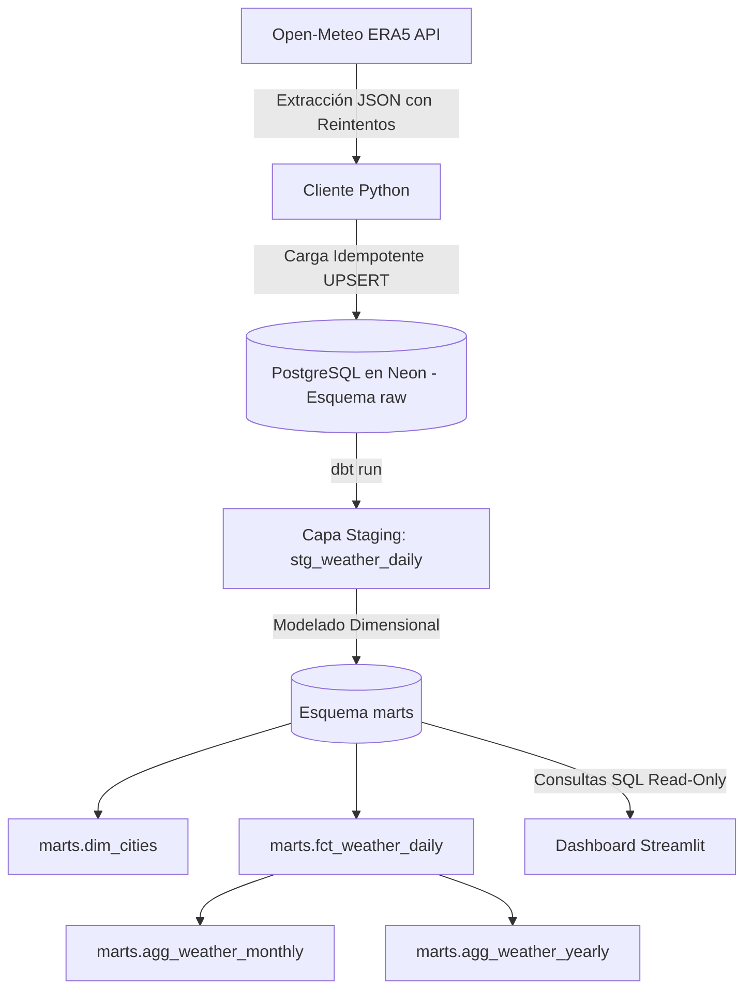

# Construyendo un pipeline ELT automatizado con Python, dbt, PostgreSQL y GitHub Actions

## 1. Introducción al problema de ingeniería de datos

En proyectos de análisis de datos del mundo real, uno de los desafíos más habituales no radica únicamente en calcular métricas estadísticas o generar gráficos atractivos, sino en garantizar que la ingestión, persistencia y transformación de la información ocurran de forma **confiable, desatendida y reproducible**.

En el ámbito meteorológico, los datos climáticos históricos presentan retos particulares:
* **Disponibilidad asíncrona:** Conjuntos de datos consolidados como el reanálisis ERA5 del ECMWF tienen retardos naturales de publicación (aproximadamente cinco días respecto a la fecha en curso).
* **Consistencia ante fallos de red:** Las consultas masivas a APIs externas están expuestas a desconexiones intempestivas, retardos y restricciones de frecuencia (códigos de estado HTTP 429).
* **Riesgo de duplicación:** Si una tarea programada se ejecuta dos veces consecutivas sin un mecanismo de unicidad transaccional, corrompe las métricas agregadas al sumar duplicados.

Para resolver estos desafíos, implementamos el proyecto **ClimaData Perú**, un pipeline automatizado bajo el paradigma moderno **ELT** (*Extract - Load - Transform*), diseñado para operar con servicios gratuitos en la nube y con altos estándares de calidad de software.

---

## 2. Objetivo del proyecto ClimaData Perú

El proyecto tiene como meta central capturar, modelar y presentar de manera automatizada las variables meteorológicas diarias de tres ciudades peruanas con pisos ecológicos marcadamente dispares:
1. **Tacna (Costa Árida Sur - 562 msnm):** Caracterizada por precipitaciones prácticamente nulas y temperaturas templadas a lo largo de todo el año.
2. **Arequipa (Sierra Andina / Valle Quechua - 2,328 msnm):** Con una elevada amplitud térmica diaria (noches frías y radiación diurna intensa) y un régimen de lluvias concentrado en los meses de verano.
3. **Lima (Costa Central Marítima - 154 msnm):** Sometida a la influencia de la corriente de Humboldt, caracterizada por alta nubosidad baja, humedad persistente en invierno y baja amplitud térmica.

La solución integra ingestión incremental con Python, almacenamiento en PostgreSQL serverless en Neon, transformaciones auditadas con dbt Core, orquestación desatendida con GitHub Actions y un panel visual público desarrollado en Streamlit.

---

## 3. Tecnologías elegidas y justificación

La selección tecnológica responde a criterios de robustez, compatibilidad con arquitecturas modernas de datos y ausencia de costes operativos:

* **Open-Meteo Historical Weather API:** Proveedor abierto que entrega datos meteorológicos de reanálisis ERA5 a resolución horaria y diaria sin requerir claves de API privativas.
* **Python 3.12+ (`requests`, `urllib3`, `pandas`):** Lenguaje estándar para la construcción de clientes HTTP resilientes y estructuración de dataframes tabulares.
* **PostgreSQL en Neon:** Plataforma de base de datos relacional serverless con separación de cómputo y almacenamiento, que provee instancias Postgres 16 en su capa gratuita con soporte nativo de transacciones ACID y sentencias `ON CONFLICT DO UPDATE` (UPSERT).
* **dbt Core (`dbt-postgres`):** El estándar de facto en ingeniería de análisis (*Analytics Engineering*). Permite modelar mediante SQL declarativo, gestionar el linaje entre capas y compilar pruebas automatizadas de calidad de datos.
* **GitHub Actions:** Orquestador CI/CD sin servidor integrado en el repositorio, ideal para ejecutar pruebas unitarias automáticas y programar ejecuciones periódicas mediante expresiones cron.
* **Streamlit y Plotly:** Framework reactivo en Python para crear tableros analíticos interactivos y ligeros, consumiendo datos con permisos de solo lectura.

---

## 4. Arquitectura del pipeline ELT

A diferencia de los pipelines ETL tradicionales donde los datos se transforman en memoria antes de ingresar a la base de datos, en este proyecto adoptamos el enfoque **ELT**:



### Ventajas del enfoque adoptado:
1. **Preservación del dato crudo:** La tabla `raw.weather_daily` almacena las observaciones tal como provienen de la fuente, permitiendo recomputar modelos futuros sin necesidad de consultar nuevamente la API externa.
2. **Transformación in-database:** El motor PostgreSQL ejecuta las agregaciones, aprovechando índices y optimizaciones del motor relacional.
3. **Auditoría explícita:** Cada fase registra marcas de tiempo, número de registros e identificadores únicos de corrida en `raw.pipeline_runs`.

---

## 5. Extracción desde Open-Meteo con Python

El cliente extractor se construyó en la clase `OpenMeteoExtractor` (`src/extractor/open_meteo.py`). Para garantizar que las peticiones HTTP no colapsen ante intermitencias de red o códigos 429 por saturación de peticiones, se configuró una política de reintentos con descarte y retroceso exponencial (*exponential backoff*):

```python
from requests.adapters import HTTPAdapter
from urllib3.util.retry import Retry
import requests

def _build_session(self) -> requests.Session:
    session = requests.Session()
    retries = Retry(
        total=4,
        backoff_factor=1.5,
        status_forcelist=[429, 500, 502, 503, 504],
        allowed_methods=["GET"],
        raise_on_status=False,
    )
    adapter = HTTPAdapter(max_retries=retries)
    session.mount("https://", adapter)
    session.mount("http://", adapter)
    return session
```

El cliente solicita mediciones de temperatura (mínima, media y máxima), precipitación acumulada, velocidad y ráfagas de viento, y radiación solar incidente. Al recibir el JSON estructurado por vectores temporales, lo convierte en un DataFrame canónico añadiendo marcas de tiempo de extracción en formato UTC e identificador de fuente.

---

## 6. Almacenamiento en PostgreSQL y Neon

Para el almacenamiento se diseñaron dos esquemas lógicos:
* `raw`: Zona de aterrizaje para datos sin transformar y auditoría.
* `marts`: Capa analítica consumible gobernada por dbt.

### Idempotencia mediante UPSERT
Para evitar que corridas repetidas creen duplicados o arrojen errores de clave duplicada, la tabla `raw.weather_daily` cuenta con una clave primaria compuesta sobre `(city_code, date)`:

```sql
INSERT INTO raw.weather_daily (
    city_code, city_name, department, region, latitude, longitude, elevation,
    date, temperature_max, temperature_min, temperature_mean, precipitation_sum,
    rain_sum, wind_speed_max, wind_gusts_max, solar_radiation, extracted_at, source
) VALUES (
    :city_code, :city_name, :department, :region, :latitude, :longitude, :elevation,
    :date, :temperature_max, :temperature_min, :temperature_mean, :precipitation_sum,
    :rain_sum, :wind_speed_max, :wind_gusts_max, :solar_radiation, :extracted_at, :source
) ON CONFLICT (city_code, date) DO UPDATE SET
    temperature_max = EXCLUDED.temperature_max,
    temperature_min = EXCLUDED.temperature_min,
    temperature_mean = EXCLUDED.temperature_mean,
    precipitation_sum = EXCLUDED.precipitation_sum,
    wind_speed_max = EXCLUDED.wind_speed_max,
    solar_radiation = EXCLUDED.solar_radiation,
    extracted_at = EXCLUDED.extracted_at,
    updated_at = CURRENT_TIMESTAMP;
```

Esta instrucción garantiza que, si se reprocesa un periodo ya existente, las columnas se actualizan de forma transparente sin generar registros redundantes.

---

## 7. Transformación y pruebas con dbt Core

La capa de transformación (`dbt_project/`) se organizó en dos etapas:

### 1. Staging (`stg_weather_daily.sql`)
Se materializa como vista sobre `raw.weather_daily`. Realiza el casteo riguroso de tipos, genera una clave subrogada determinística con `MD5(CONCAT(city_code, '_', date))` y calcula métricas derivadas como la oscilación térmica (`temperature_max - temperature_min`) y banderas lógicas (`is_rainy_day`, `is_heat_day`, `is_cold_day`).

### 2. Marts
* `dim_cities`: Dimensión de ciudades enriquecida con los pisos altitudinales de la geografía peruana (Chala, Yunga y Quechua).
* `fct_weather_daily`: Tabla de hechos granular a nivel diario.
* `agg_weather_monthly`: Tabla agregada que totaliza precipitaciones mensuales, días lluviosos, promedios de radiación solar y temperaturas extremas.
* `agg_weather_yearly`: Resumen climatológico anual consolidado.

### Calidad de datos y pruebas automáticas
Se configuraron pruebas en `schema.yml` para auditar la integridad:
* `not_null` y `unique` en claves primarias y foráneas.
* `accepted_values` en códigos de ciudad (`['TAC', 'AQP', 'LIM']`).
* `relationships` para validar la integridad referencial entre la tabla de hechos y la dimensión de ciudades.
* Un test singular personalizado (`assert_temperature_consistency.sql`) que comprueba que la temperatura máxima sea siempre mayor o igual a la mínima registrada.

---

## 8. Automatización mediante GitHub Actions

La automatización del ciclo de vida se dividió en dos flujos desacoplados:

### Flujo 1: Integración Continua (`ci.yml`)
Se activa ante cada `push` o `pull_request` a la rama principal. Instala dependencias, ejecuta las 9 pruebas unitarias de `pytest` (que prueban el extractor simulado con `responses` y el loader con SQLite) y valida la compilación sintáctica de dbt (`dbt parse`).

### Flujo 2: Pipeline Programado (`pipeline.yml`)
Diseñado para la sincronización periódica de datos:
* **Disparador programado:** Expresión cron `'0 11 * * *'` (06:00 AM hora de Lima).
* **Disparador manual:** `workflow_dispatch` con selector de modo (`incremental` o `initial`).
* **Seguridad:** Los parámetros de conexión (`NEON_DATABASE_URL`, `DB_HOST`, `DB_USER`, `DB_PASSWORD`) se inyectan dinámicamente mediante **GitHub Secrets**, garantizando que ninguna credencial quede expuesta en el código fuente.

---

## 9. Construcción del dashboard Streamlit

Para el consumo analítico, desarrollamos un dashboard interactivo en `app/main.py`. Entre sus características destacan:
* **Badge de estado en vivo:** Lee la tabla `raw.pipeline_runs` y muestra la marca temporal de la última corrida exitosa y el número de filas sincronizadas.
* **Separación de privilegios:** El dashboard se conecta a PostgreSQL utilizando un rol de base de datos de solo lectura (`streamlit_reader`), imposibilitando modificaciones accidentales de los datos.
* **Visualizaciones con Plotly:**
  * Curvas de temperatura diaria con bandas sombreadas del rango térmico y media móvil de 30 días para resaltar tendencias estacionales.
  * Gráfico de barras de precipitación acumulada con eje secundario de días con lluvia.
  * Pestaña comparativa multiciudad que contrasta el clima hiperárido de Tacna frente a las lluvias estivales de Arequipa y la humedad costera de Lima.
* **Modo resiliente sin conexión:** En caso de que la conexión a la base de datos no esté configurada en el entorno local, el aplicativo activa automáticamente un generador de muestras calibrado con los perfiles climáticos peruanos, evitando bloqueos de interfaz.

---

## 10. Despliegue en la nube

El despliegue se estructuró enteramente sobre capas gratuitas:
1. **Neon PostgreSQL:** Se creó el proyecto en Neon, ejecutando los scripts DDL en `sql/01_init_schema.sql` y `sql/02_create_roles.sql`.
2. **Streamlit Community Cloud:** Se vinculó el repositorio de GitHub al servicio en la nube, apuntando a `app/main.py` y configurando el secreto `NEON_DATABASE_URL` en la interfaz de administración. Cada nuevo push a la rama `main` dispara automáticamente la actualización del despliegue.

---

## 11. Pruebas y resultados reales

Durante la fase de validación se obtuvieron los siguientes resultados demostrables:

```bash
$ pytest -v
tests/test_config.py::test_cities_definition PASSED                      [ 11%]
tests/test_config.py::test_meteorological_variables PASSED               [ 22%]
tests/test_config.py::test_settings_connection_url PASSED                [ 33%]
tests/test_extractor.py::test_fetch_city_weather_success PASSED          [ 44%]
tests/test_extractor.py::test_fetch_city_weather_empty_response PASSED   [ 55%]
tests/test_loader.py::test_init_schema PASSED                            [ 66%]
tests/test_loader.py::test_pipeline_run_lifecycle PASSED                 [ 77%]
tests/test_loader.py::test_idempotent_upsert PASSED                      [ 88%]
tests/test_transformations.py::test_thermal_range_and_flags_logic PASSED [100%]
============================== 9 passed in 4.20s ==============================
```

En las pruebas de idempotencia, se ejecutó dos veces consecutivas la ingestión de observaciones idénticas sobre la base de datos; la segunda corrida ejecutó la cláusula `ON CONFLICT DO UPDATE`, manteniendo el total de registros inalterado en 15 filas y certificando la no duplicidad.

---

## 12. Problemas encontrados y soluciones

Durante el desarrollo se presentaron los siguientes desafíos técnicos:

1. **Retardo temporal en datos ERA5:** Al consultar fechas recientes, la API arrojaba respuestas vacías o nulas debido a los 5 días de latencia natural del modelo.
   * *Solución:* Se ajustó la función `determine_date_range()` en `scripts/run_pipeline.py` para calcular como límite superior seguro `hoy - 5 días`.
2. **Compatibilidad de conectores en Python 3.13:** Algunos entornos recientes de Python presentan incompatibilidades de compilación con ruedas binarias tradicionales de `psycopg2-binary`.
   * *Solución:* Se incorporó soporte dual con `psycopg[binary]>=3.2.0` y `psycopg2-binary` condicional por versión en `requirements.txt`.
3. **Sintaxis moderna de tests en dbt 1.8+:** Las versiones contemporáneas de dbt marcan como obsoleto el bloque `tests:` dentro de las definiciones de columnas.
   * *Solución:* Se actualizó la totalidad de los archivos `schema.yml` al estándar `data_tests:`.

---

## 13. Aprendizajes y conclusiones

1. **La idempotencia no es opcional en Data Engineering:** Diseñar cargas que toleren múltiples ejecuciones sin corromper el estado es indispensable para pipelines automatizados.
2. **dbt aporta rigor de ingeniería al SQL:** El desacoplamiento entre staging y marts, sumado a las pruebas integradas, transforma consultas dispersas en activos de datos confiables y documentados.
3. **El stack moderno es accesible sin coste:** Integrar herramientas como Open-Meteo, Neon, dbt Core, GitHub Actions y Streamlit demuestra que es factible edificar infraestructuras de datos de nivel profesional sin incurrir en costes de infraestructura propietaria.

---

## 14. Referencias técnicas oficiales

* Documentación de la API de Open-Meteo: [https://open-meteo.com/en/docs](https://open-meteo.com/en/docs)
* Documentación de dbt Core: [https://docs.getdbt.com/docs/introduction](https://docs.getdbt.com/docs/introduction)
* Guía oficial de Neon PostgreSQL: [https://neon.tech/docs/introduction](https://neon.tech/docs/introduction)
* Documentación de GitHub Actions: [https://docs.github.com/en/actions](https://docs.github.com/en/actions)
* Documentación de Streamlit: [https://docs.streamlit.io/](https://docs.streamlit.io/)

---

## 15. Enlaces del proyecto

* **Código fuente en GitHub:** [https://github.com/Hashiravc/climapipe](https://github.com/Hashiravc/climapipe)
* **Dashboard interactivo en la nube:** [https://climadata-peru.streamlit.app/](https://climadata-peru.streamlit.app/)
* **Guion del video demostrativo:** [docs/video-script.md](docs/video-script.md)
